Прототип інструмента, який бере на себе рутину продуктового аналітика: профілювання даних, пошук гіпотез,
відповіді на питання природною мовою, пояснення стрибків метрик і executive summary.
Pandas рахує, LLM інтерпретує. Модель ніколи не бачить сирих рядків і не рахує числа.
Вона отримує готові факти з ID (F1, F2…), а код перевіряє, що її твердження посилаються на існуючі факти,
а числа в тексті є в джерелі. Впевненість у причинах рахує код за z-статистикою, а не модель.

Інструмент протестовано на реальному датасеті Olist (бразильський e-commerce, 111 752 рядки та 41 колонка)
і на синтетичному датасеті з підкинутою аномалією, відомою заздалегідь (150 тис. рядків).

## Реалізовані функції

| № | Функція | Модуль | Як працює |
|---|---|---|---|
| 1 | Автоматичний EDA | `analyst/eda.py` | Pandas профілює кожну колонку; LLM пише інтерпретацію й проблеми. Оцінку якості (1–10) рахує код за правилом і показує розбивку |
| 2 | Генерація гіпотез | `analyst/hypotheses.py` | Pandas будує пронумеровані факти (сегменти з z-статистикою); LLM формулює 5–10 гіпотез із посиланнями на факти. Гіпотези з вигаданими ID відкидаються |
| 3 | NL - Pandas | `analyst/nl2pandas.py` | LLM генерує код, він перевіряється AST-фільтром, виконується в обмеженому середовищі; код завжди видно. Якщо код падає, модель виправляє його (до 2 разів). Нелогічні питання відхиляються з поясненням |
| 4 | Пояснення аномалій | `analyst/anomaly.py` | Декомпозиція зміни метрики за сегментами та їх перетинами, надлишковий внесок, z-тест, explain-away, динаміка по днях. LLM лише формулює гіпотези причин |
| 5 | Executive summary | `analyst/summary.py` | Короткий текст для CEO з відсотками, п.п. і бізнес-метриками, які порахував Pandas |
| 6 | Власна функція: шар верифікації | `analyst/verify.py` + `generate_synthetic.py` | Перевірка чисел у відповіді LLM проти джерела; синтетичний датасет із відомою причиною для доказу коректності інструмента |

## Приклади результатів (Olist)

- **EDA.** Інструмент помітив, що чотири колонки (`order_delivered_customer_date`, `delivery_days`, `delay_days`, `is_late`)
  мають однакові 1.68% пропусків (спільна причина), а також цінові викиди (7.44%, max=6735 при median=75).
- **NL - Pandas.** «Скільки унікальних замовлень було у листопаді 2017?» - `nunique()` по `order_id` - **7421**
  (збігається з незалежним розрахунком). На питання «Який настрій у клієнтів?» інструмент відповів, що такої
  колонки немає, і запропонував питання через `review_score`.
- **Пояснення аномалії (листопад 2017).** Частка запізнень зросла з 5.06% до 13.83%.
  Інструмент показав, що зміна системна (без продавців SP лишається 64% зміни), що аномальний маршрут SP - RJ
  і що запізнення сконцентровані 25–27 листопада 2017 (21–23% проти медіани 4.6%).
- **Доказ коректності (синтетичні дані).** З 16.10.2026 конверсія в сегменті `paid_social та android` падає
  у 5 разів. Інструмент знайшов саме цей сегмент, а загальну зміну правильно визнав шумом.

## Скріншоти:

**1. Автоматичний EDA.**
<p align="center">
  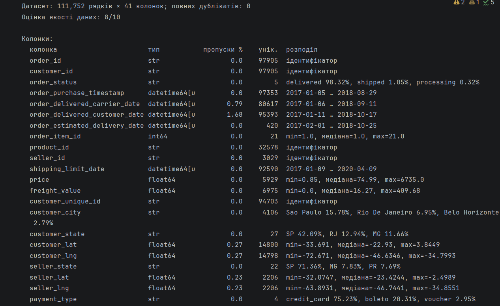
  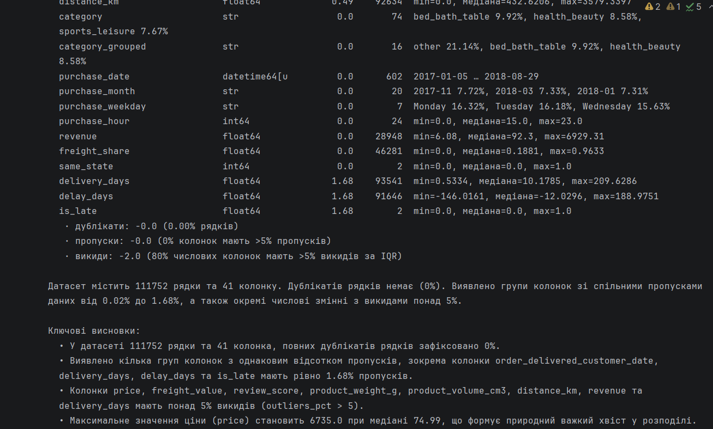
  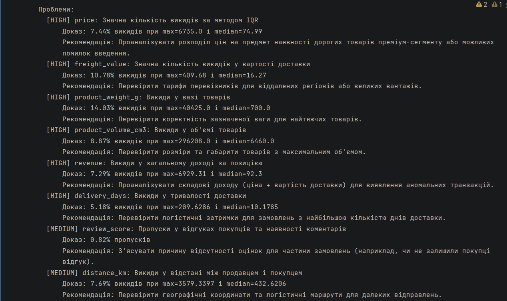
  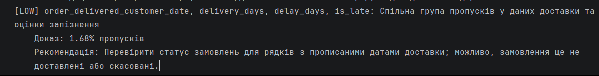
  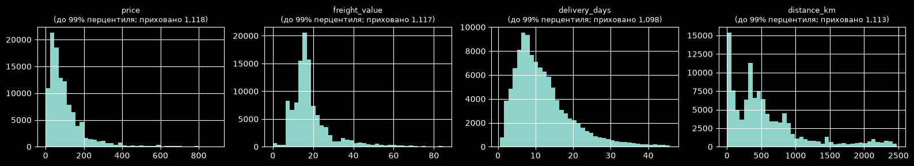
</p>

**2. Гіпотези.**
<p align="center">
  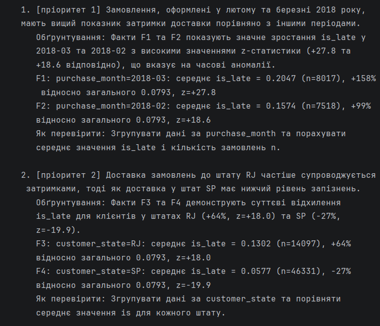
  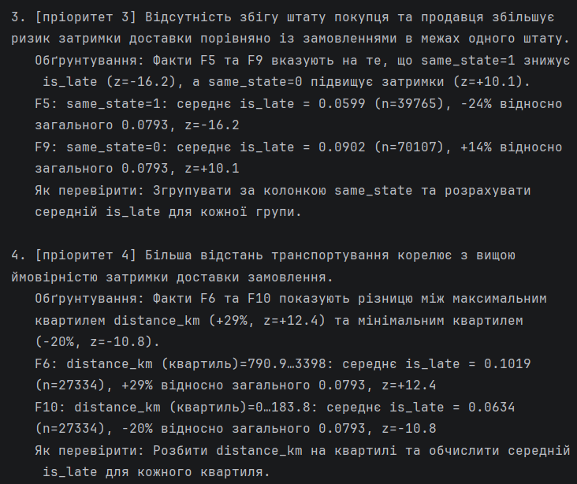
  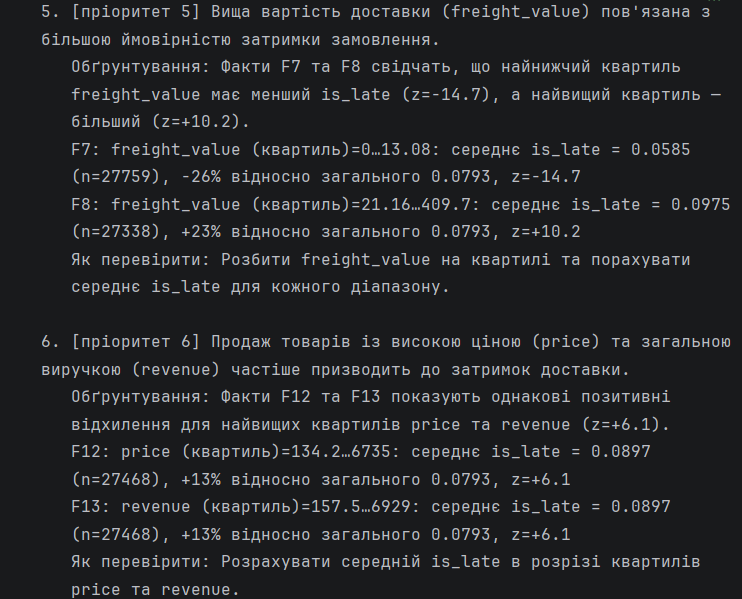
  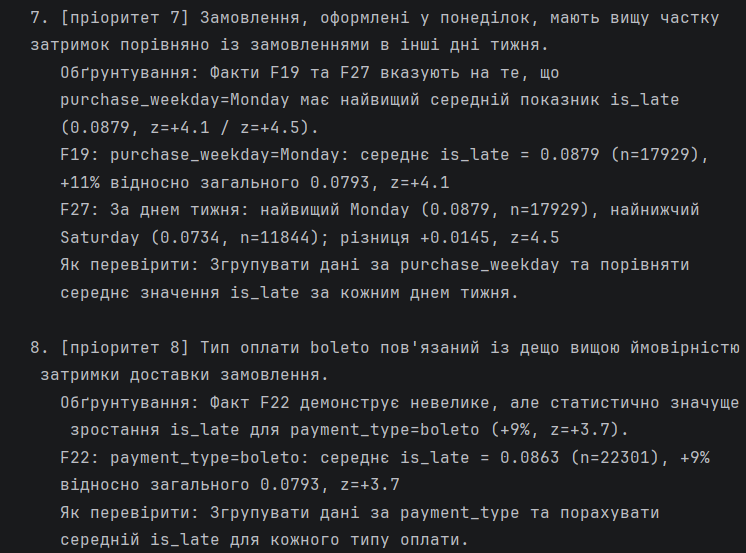
</p>

**3. NL - Pandas.**
<p align="center">
  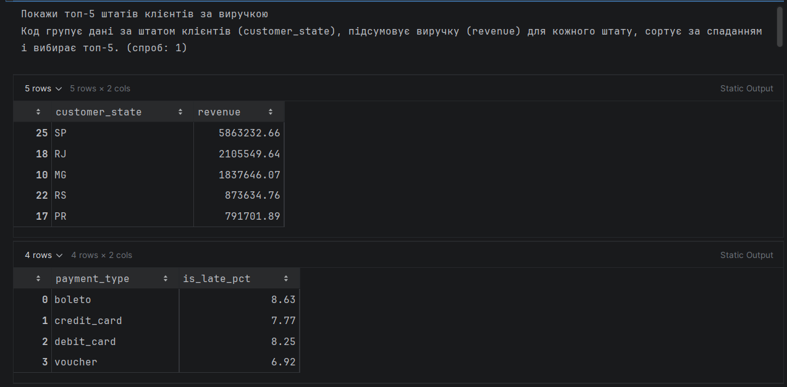
  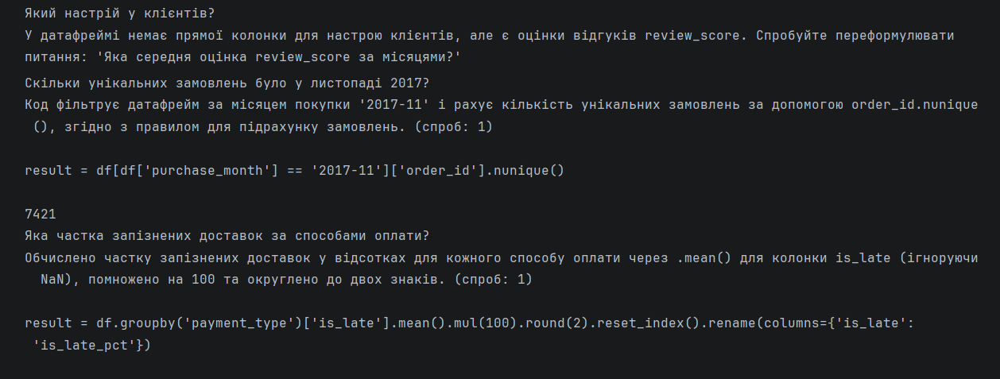
</p>

**4. Пояснення аномалії.**
<p align="center">
  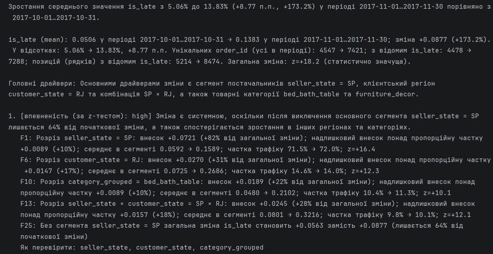
  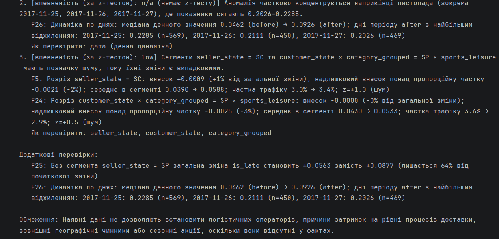
  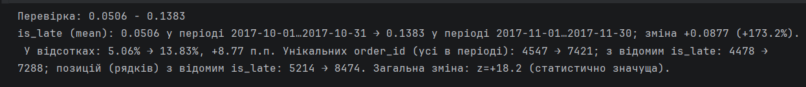
  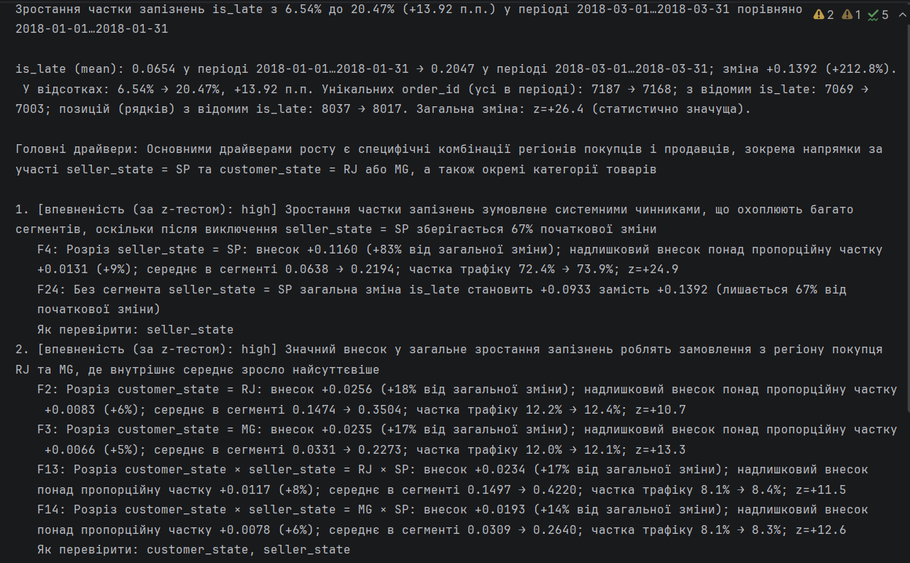
  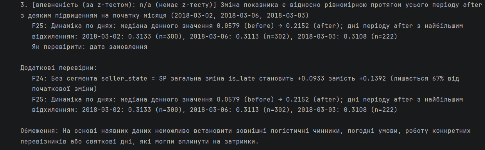
</p>

**5. Доказ коректності на синтетичних даних.**
<p align="center">
  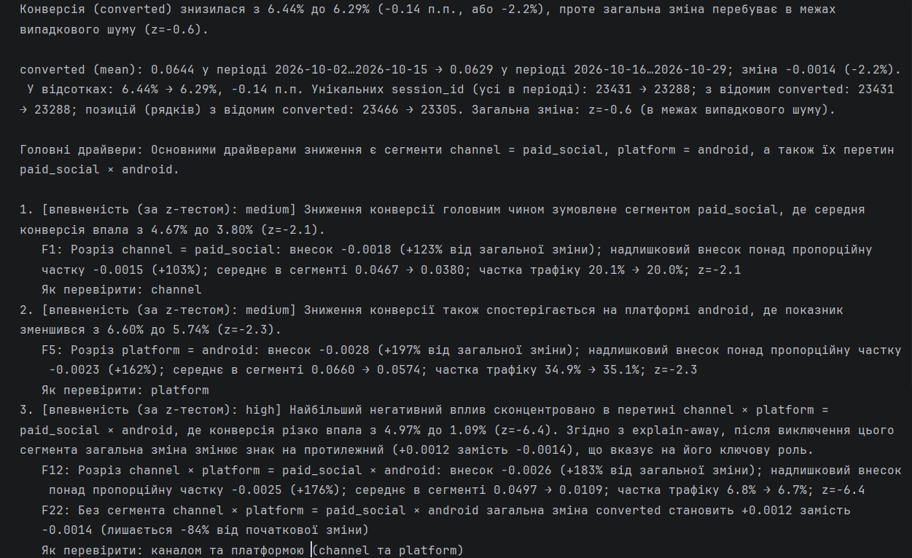
  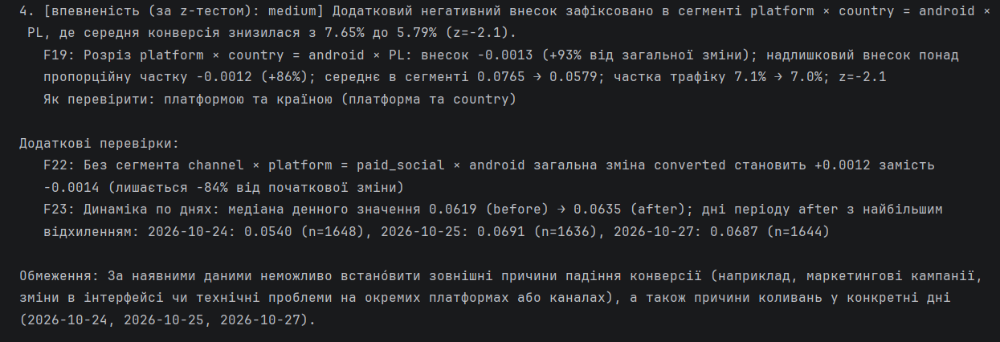
</p>

**6. Executive summary.**
<p align="center">
  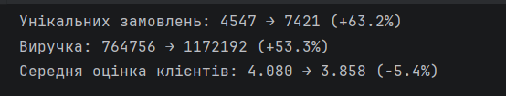
</p>

**7. Офлайн-тести (без API-ключа).**
<p align="center">
  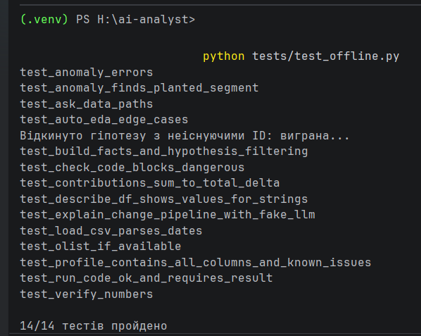
</p>

## Структура репозиторію

```
analyst/            # бібліотека: eda, hypotheses, nl2pandas, anomaly, summary, verify, llm, display, utils
tests/test_offline.py   # 14 тестів без звернень до LLM
preprocess_olist.py     # очищення й об'єднання 9 таблиць Olist
generate_synthetic.py   # синтетичні дані з підкинутою аномалією
demo.ipynb              # демонстрація всіх функцій
prompts.md              # усі промпти та історія їх ітерацій
```

## Запуск
1. **Встановіть залежності** (Python 3.10+):
   ```bash
   python -m venv .venv
   # Windows: .venv\Scripts\activate      Linux/macOS: source .venv/bin/activate
   pip install -r requirements.txt
   ```
2. **Отримайте API-ключ Gemini**: https://aistudio.google.com/apikey. Створіть файл `.env` у корені:
   ```
   GEMINI_API_KEY=ключ
   GEMINI_MODEL=<назва моделі>
   ```
3. **Завантажте дані** Olist: https://www.kaggle.com/datasets/olistbr/brazilian-ecommerce, розпакуйте CSV у `data/raw/`.
4. **Підготуйте дані**:
   ```bash
   python preprocess_olist.py --raw data/raw --out data/olist_clean.csv
   python generate_synthetic.py
   ```
5. **Запустіть тести** (ключ не потрібен):
   ```bash
   python tests/test_offline.py
   ```
6. **Відкрийте демо**: `jupyter notebook demo.ipynb` і виконайте клітинки зверху вниз.

## Захист від галюцинацій

- LLM не отримує сирих даних, лише розраховані факти з ID. Поточний вихід строго структурований
  (JSON-схеми pydantic).
- Гіпотези та причини з неіснуючими ID фактів відкидаються кодом.
- Числа у відповіді перевіряються проти джерела (`verify.py`); підозрілі виводяться як попередження.
- Впевненість у причинах («low/medium/high») рахується кодом за z-статистикою.
- Код NL-Pandas проходить AST-фільтр (заборонені імпорти, файловий ввід-вивід, dunder-атрибути) і
  виконується з обмеженими builtins.
- Тести: `tests/test_offline.py` перевіряє пайплайн із підміненою LLM, у тому числі пошук підкинутого сегмента.

## Технології
Python, Pandas, NumPy, Pydantic, Google Gemini API, Matplotlib, Jupyter. Датасет: Olist Brazilian E-Commerce (Kaggle).